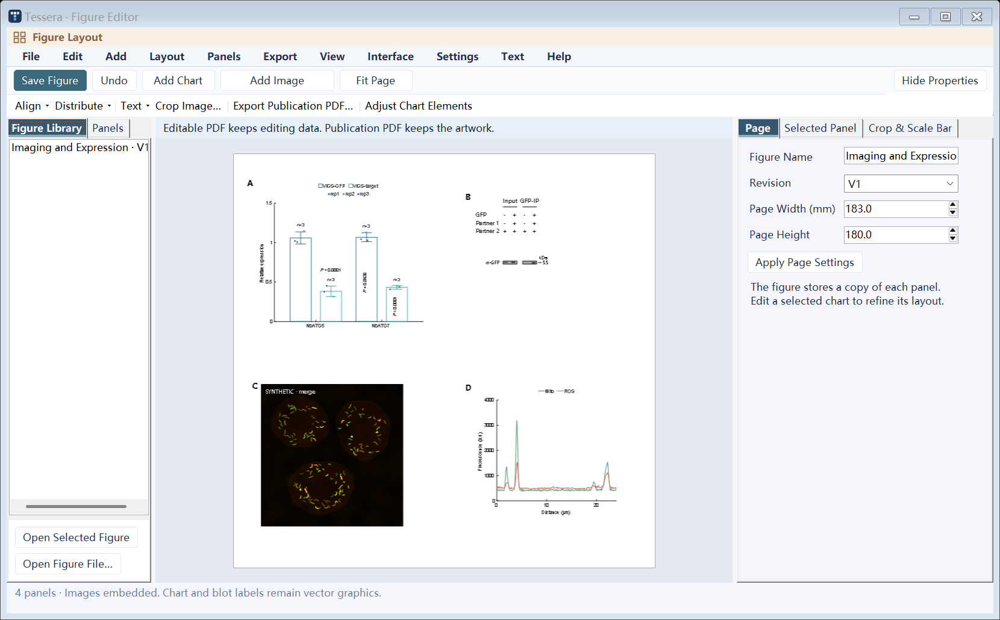
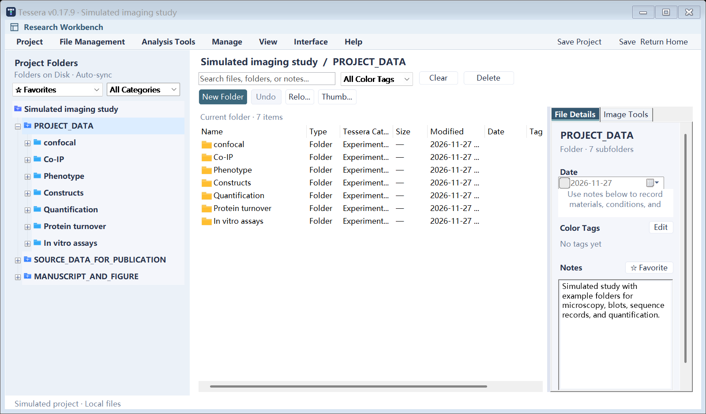
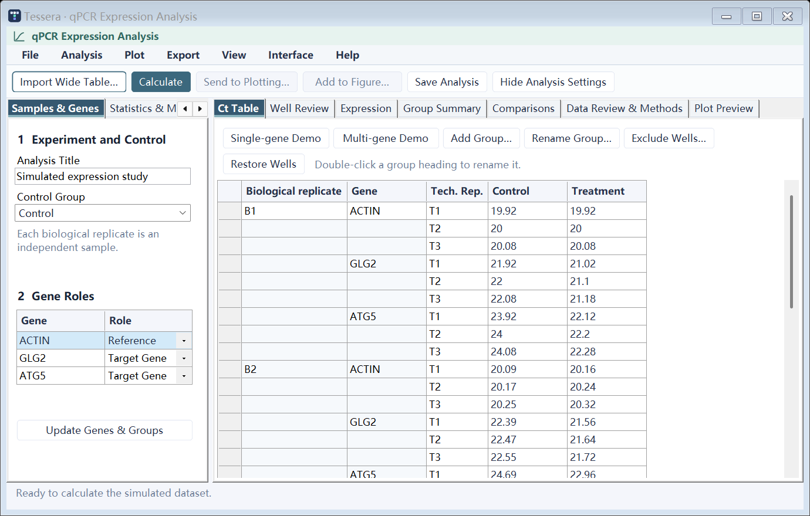
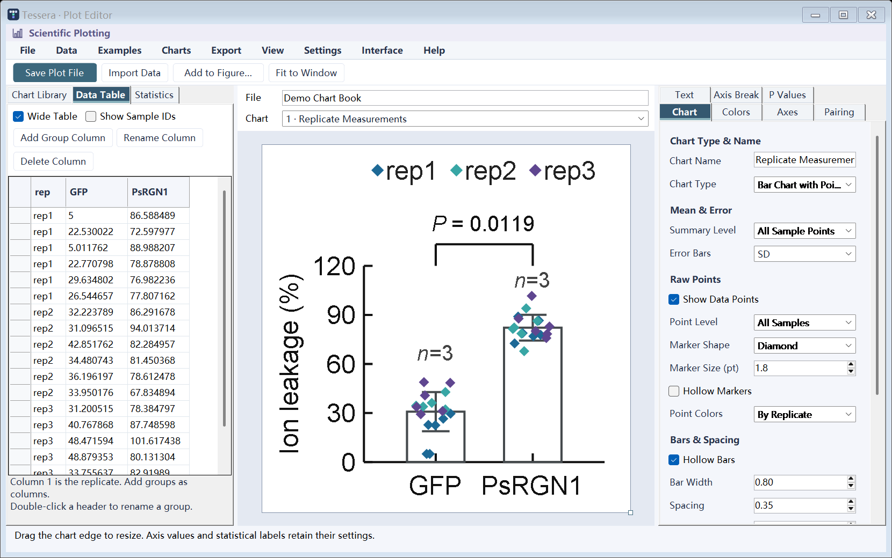
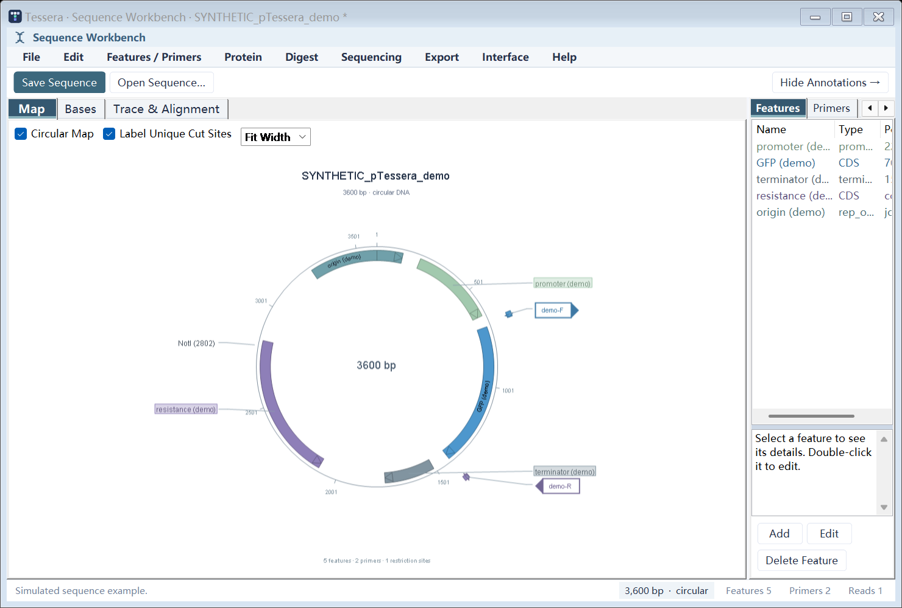

# Tessera

**Windows 科研数据工作台 · Research workbench for Windows**

Tessera 把实验文件、分析结果和论文图放在同一个项目里。可以打开已有实验文件夹，也可以新建项目，边查看原始数据边整理结果。  
Tessera brings experiment files, analysis, and publication figures into one project. Open an existing experiment folder or start a new project, then review the source data alongside your results.

[下载 Windows 版 · Download for Windows](https://github.com/Alarics537/Tessera/releases/latest) · [中文](#中文) · [English](#english) · [界面预览 · Screenshots](#screenshots)

*组图工作台 · Figure editor. 英文界面预览使用模拟数据。 The English interface previews use simulated data.*

## 中文

- **整理已有实验文件。** 给原始图片、表格和分析结果加标签、实验日期、收藏和备注。打开普通文件夹时，可以为现有子目录指定分类，沿用原有目录结构。
- **从 Ct 表到表达量图。** 导入 Excel 或 CSV，指定技术重复、生物学重复、内参和参照组。核对逐孔数据、相对表达量和显著性后，可以把结果送入绘图或直接加入组图。
- **绘制统计图并继续调整。** 用同一套数据制作柱状图、箱线图、散点图或折线图。可显示重复点、误差线及 P 值，调整后保存为可重新打开的工作文件。
- **处理实验图片与序列。** Western blot 支持原膜与条带裁剪、泳道标注和原图归档。显微图像可做标定、面积与计数、线扫描和共定位分析。序列工具提供质粒图谱、特征与引物管理、AB1 峰图比对，另有蛋白多序列比对工具。
- **组装可继续编辑的论文图。** 把图表、条带和显微图像排到同一画布，调整标签、对齐、间距和标尺。可保留 Tessera 组图工作文件或含编辑数据的 PDF，也可导出精简 PDF 用于交付。

从 [Releases](https://github.com/Alarics537/Tessera/releases/latest) 下载 Windows 压缩包，解压后打开 `Tessera.exe`。随包提供模拟项目、示例数据和离线手册，按 **F1** 可在软件内打开手册。可以同时打开多个工具窗口，项目文件保存在本机。目前英文界面覆盖主要菜单和常用控件，部分高级设置仍使用中文。

## English

- **Organize existing experiment files.** Add tags, experiment dates, favorites, and notes to source images, spreadsheets, and analysis outputs. Assign categories to existing subfolders while keeping your folder structure.
- **Go from Ct tables to expression plots.** Import Excel or CSV data and identify technical replicates, biological replicates, reference genes, and a control group. Review individual wells, relative expression, and statistical comparisons, then send the results to the plotting tool or add them to a figure.
- **Create and revise scientific plots.** Use the same dataset for bar, box, scatter, or line charts. Show replicate points, error bars, and P values, and save editable work files for later revisions.
- **Work with experimental images and sequences.** Crop Western blot membranes and bands, label lanes, and archive the original images. Calibrate microscopy images and use measurements, counting, line scans, and colocalization. Browse plasmid maps, manage features and primers, align AB1 traces, or work with multiple protein sequences in the alignment tool.
- **Assemble figures you can continue editing.** Arrange charts, blot panels, and microscopy images on one canvas. Adjust labels, alignment, spacing, and scale bars. Keep a Tessera work file or a PDF with embedded editing data, and export a PDF without editing data for sharing or submission.

Download the Windows ZIP from [Releases](https://github.com/Alarics537/Tessera/releases/latest), extract it, and run `Tessera.exe`. It includes a sample project, example data, and an offline manual accessible with **F1**. Multiple tools can stay open together, and project files stay on your computer. Choose **界面 → 语言 / Language → English** for the main English interface. Some advanced labels in the current release remain in Chinese.

## Screenshots

### 项目管理 · Project workspace

在同一个窗口浏览实验目录、文件列表和实验记录。  
Browse experiment folders, files, and notes in one window.

### qPCR 表达分析 · qPCR expression analysis

用宽表管理重复、基因角色和参照组，按页查看表达量及统计结果。  
Organize replicates, gene roles, and controls in a wide table, then review expression and statistics in dedicated tabs.

### 科研绘图 · Scientific plotting

数据表、图形预览和样式设置并排显示。  
Edit the data table and chart settings beside the live preview.

### 序列工作台 · Sequence workspace

在环形图谱、碱基序列和峰图之间切换。  
Switch between the circular map, base sequence, and sequencing trace views.

